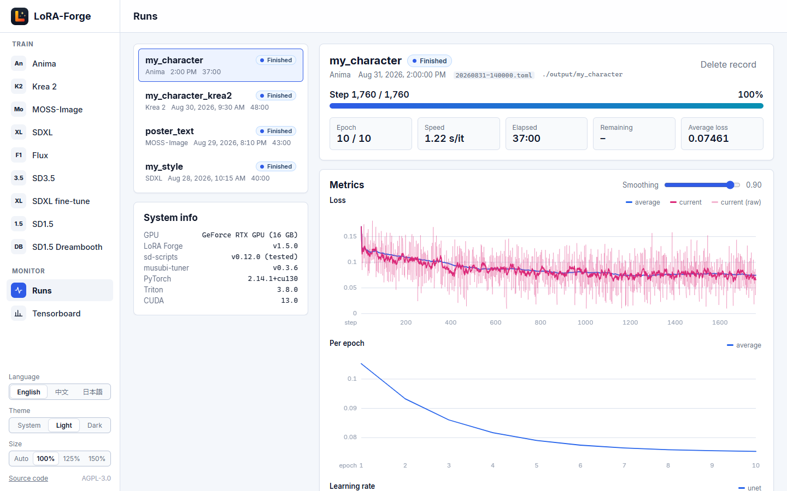
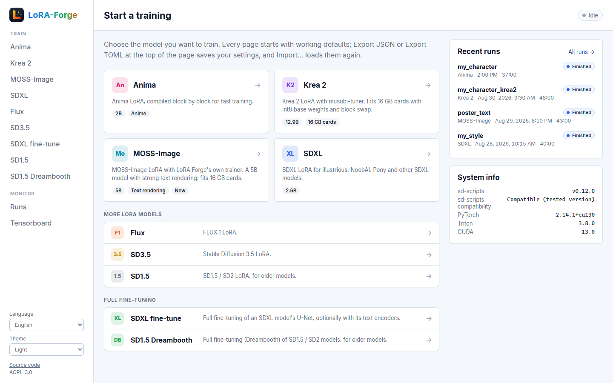
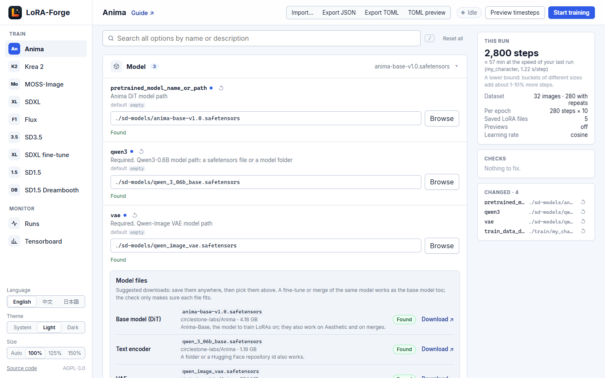

<div align="center">


# LoRA Forge

_✨ Enjoy LoRA training! ✨_

</div>

<p align="center">
  <a href="https://github.com/PineCookie/lora-forge" style="margin: 2px;">
    
  </a>
  <a href="https://github.com/PineCookie/lora-forge" style="margin: 2px;">
    
  </a>
  <a href="https://raw.githubusercontent.com/PineCookie/lora-forge/main/LICENSE" style="margin: 2px;">
    
  </a>
  <a href="https://github.com/PineCookie/lora-forge/releases" style="margin: 2px;">
    
  </a>
</p>

<p align="center">
  <a href="https://github.com/PineCookie/lora-forge/releases">Download</a>
  ·
  <a href="docs/anima.md">Anima guide</a>
  ·
  <a href="docs/krea2.md">Krea 2 guide</a>
  ·
  <a href="docs/moss-image.md">MOSS-Image guide</a>
  ·
  <a href="README-zh.md">中文</a>
</p>

LoRA Forge is a web UI for training LoRAs. You pick a model, fill in a form in the browser, press Start and follow the training on a live page; LoRA Forge sets up Python, PyTorch and the trainers for you. Under the hood it runs [kohya-ss/sd-scripts](https://github.com/kohya-ss/sd-scripts), [kohya-ss/musubi-tuner](https://github.com/kohya-ss/musubi-tuner) (Krea 2) and its own MOSS-Image trainer, sped up where they are slow. It continues [lora-scripts](https://github.com/Akegarasu/lora-scripts).

<picture>
  <source media="(prefers-color-scheme: dark)" srcset="docs/images/runs-dark.png">
  
</picture>

- **Models**: Anima, Krea 2, MOSS-Image, SDXL (Illustrious, NoobAI, Pony, ...), FLUX, SD3.5 and SD1.5, plus full fine-tuning for SDXL and SD1.5 (Dreambooth). Each model has its own page with sensible defaults.
- **Easy forms**: an *Essentials* view with the options most people change, all options one click away, search, and import / export of configs as JSON or TOML. Anima, Krea 2 and MOSS-Image list the files they need, with download links, and check the files you pick.
- **Runs page**: progress and time left, loss and learning rate charts, sample images, the saved LoRA files and the console output, also for past runs. No TensorBoard needed.
- **Faster training**: an SDXL LoRA trains about twice as fast as with plain sd-scripts, and Anima, Krea 2 and MOSS-Image are faster too. Most of it is on by default ([details](#speed)).
- **Krea 2 on 16 GB cards**: int8 base weights and block swap by default ([details](docs/krea2.md)).
- **MOSS-Image**: OpenMOSS's 5B model with strong text rendering, trained with LoRA Forge's own trainer on 16 GB cards ([details](docs/moss-image.md)).
- English, 中文 and 日本語, light and dark mode.

<picture>
  <source media="(prefers-color-scheme: dark)" srcset="docs/images/home-dark.png">
  
</picture>

> [!NOTE]
> LoRA Forge is maintained mainly for personal use, so expect rough edges. Bug reports, suggestions and PRs are welcome.

## Quick start

### What you need

- Windows or Linux with an **NVIDIA GPU, RTX 20 series or newer** (compute capability 7.5), and **driver 580 or newer** (LoRA Forge uses PyTorch 2.14 for CUDA 13.0). GTX 10 series and older cards are not supported by CUDA 13, and other GPU brands are not supported yet. An RTX 30 series card or newer is recommended: bf16 training and flash-attn need it, and on an RTX 20 series card you choose fp16 instead. The **System info** panel on the home page shows whether your GPU is supported.
- **VRAM**: Anima and SDXL LoRAs need about 9 GB with the default settings at batch size 2 and 1024×1024. MOSS-Image and Krea 2 are set up for 16 GB cards; Krea 2 also fits 12 GB with more `blocks_to_swap`.
- [Git](https://git-scm.com/downloads), which the launcher uses to download sd-scripts and musubi-tuner.
- [uv](https://docs.astral.sh/uv/), which installs Python and everything else. Install it with the official installer, then **open a new terminal**:

  ```powershell
  powershell -ExecutionPolicy ByPass -c "irm https://astral.sh/uv/install.ps1 | iex"   # Windows
  ```

  ```sh
  curl -LsSf https://astral.sh/uv/install.sh | sh   # Linux
  ```

### Install and start

1. Download the latest `lora-forge-<version>.zip` from [Releases](https://github.com/PineCookie/lora-forge/releases) and extract it to a folder with enough free space (the environment and models take several GB).
2. Start it:
   - **Windows**: right-click `run_gui.ps1` → *Run with PowerShell*, or run `.\run_gui.ps1` in a terminal.
   - **Linux**: `bash run_gui.sh`.

   In mainland China, add `--cn` (`.\run_gui.ps1 --cn`) to download through the TUNA PyPI mirror and hf-mirror.
3. Open [http://127.0.0.1:28000](http://127.0.0.1:28000) (or start with `--open-browser`).

The first start downloads Python, PyTorch, sd-scripts and musubi-tuner and takes a while; later starts are quick. There is no separate install step.

## Training your first LoRA

**1. Prepare the dataset.** Put your images in subfolders named `<repeats>_<name>` inside one dataset folder. The number is how often each image is used per epoch. Each image can have a caption in a `.txt` file with the same name:

```
train/my_character/          ← choose this folder in the GUI
├── 10_my_character/
│   ├── 001.png
│   ├── 001.txt              ← "my_character, 1girl, smile, ..."
│   └── ...
└── 5_my_character_outfit/
    └── ...
```

Images directly in the dataset folder are not used; the GUI tells you when no `<repeats>_<name>` subfolder is found. Tag lists like the one above suit Anima and SDXL; Krea 2 and MOSS-Image learn best from sentences; for MOSS-Image a caption file can hold several captions, one per line ([details](docs/moss-image.md#captions)).

**2. Get the base model.** Download the model you want to train on. Anima, Krea 2 and MOSS-Image also need a text encoder and a VAE: their pages have a **Model files** panel with a download link for each file. For SDXL, FLUX, SD3.5 and SD1.5, use any checkpoint of that model you like.

**3. Fill in the form.** Open the page for your model in the sidebar. In the *Essentials* view, set at least the base model file, the dataset folder and the output name; the other values are reasonable defaults. The step estimate next to the dataset folder shows how many steps the settings give.

<picture>
  <source media="(prefers-color-scheme: dark)" srcset="docs/images/anima-dark.png">
  
</picture>

**4. Start and watch.** Press **Start training**. The status in the header shows the progress; click it to open the run on the **Runs** page, where you see the loss, samples and console output. The LoRA files are saved to the output folder (`output/` by default) and listed on the run. They load in ComfyUI and other UIs as they are.

Each page keeps what you entered while the browser tab is open, also when you switch to the Runs page or another model and back, but not after a reload. To keep a config, use **Export JSON** or **Export TOML**, and **Import…** to load it again. Every training you start also saves its config in `config/autosave/`, which you can import as well.

## Speed

LoRA Forge runs sd-scripts and musubi-tuner unchanged and speeds them up when a training starts. Every change was checked against the original for the same losses. The numbers are the time per step, measured on an RTX 5070 Ti (16 GB) under Windows with rank-32 LoRAs at batch size 2 and about 1 megapixel; other cards gain differently.

**On by default**, nothing to set:

| What | Models | Time per step |
|---|---|---|
| Compiled model blocks (`torch.compile`) that handle every image size, so different sizes cost no new compiles | Anima, SDXL, MOSS-Image | −21% on SDXL, −29% on MOSS-Image; an Anima epoch −11% (−55% the first time) |
| flash-attn for the attention, once [flash-attn](#flash-attn-optional) is installed | SDXL, Krea 2, MOSS-Image | −17% on SDXL, −22% on Krea 2, −29% on MOSS-Image |
| PyTorch's SDPA attention instead of sd-scripts' plain attention | SDXL, SD1.5 | about half, with less VRAM |
| A faster ProdigyPlusScheduleFree optimizer step (same results) | all | −7% on Anima, −23% on SDXL |
| Block swap that costs almost no speed, so more of the model can stay in RAM | Krea 2 | same speed with far more blocks swapped |
| Training starts without DataLoader worker processes when the latents are cached | all | the first step about a minute sooner on Windows |

**Opt-in**, set on the model's page:

| Setting | Models | Time per step | Trade-off |
|---|---|---|---|
| `training_precision = fp16` (with `fp16_accumulation`, on by default) | Anima, MOSS-Image, SDXL, SD1.5 | −24% on Anima, −27% on MOSS-Image, −8% on SDXL | As precise as bf16 in our tests. Gains only on GeForce cards, not on RTX PRO or data-center cards |
| `activation_memory_budget = auto` | Anima | −8% to −11% | Uses most of the VRAM |

Together: an SDXL LoRA step went from 1.51 s (sd-scripts with SDPA) to 0.81 s with the defaults, or 0.72 s with fp16; an Anima LoRA step from 1.73 s to 1.17 s with fp16 and `activation_memory_budget = auto`. The [Anima](docs/anima.md), [Krea 2](docs/krea2.md) and [MOSS-Image](docs/moss-image.md) guides explain the options. To run sd-scripts exactly as it is (for example to compare), set the environment variable `LORA_FORGE_PATCHES=0`.

## Updating

- **LoRA Forge**: download the new release and extract it over the old folder (or into a new one and copy your `train/`, `output/` and `config/` folders), or `git pull` if you cloned the repository.
- **sd-scripts** is never updated automatically, so a working setup stays as it is. A fresh install gets the version LoRA Forge was tested with. To move to the latest sd-scripts:

  ```powershell
  .\run_gui.ps1 update-sd-scripts           # Windows
  ```

  ```sh
  bash run_gui.sh update-sd-scripts         # Linux
  ```

  `--branch <name or tag>` picks another branch or a tag (`update-sd-scripts --branch v0.12.0`). The update stops instead of overwriting changes you made in `scripts/sd-scripts`. The **System info** panel on the home page shows whether the installed sd-scripts supports every option of the GUI.
- **musubi-tuner** (Krea 2) works the same way: `update-musubi-tuner [--branch <name or tag>]` updates `scripts/musubi-tuner`.

## Options

### flash-attn (optional)

[flash-attn](https://github.com/Dao-AILab/flash-attention) is a faster attention implementation (see [Speed](#speed)). It is not installed by default. Once it is, the SDXL, Krea 2 and MOSS-Image pages use it automatically; on the Anima page choose it with `attn_mode = flash`. To install it, run this once in the LoRA Forge folder (Windows, or Linux on x86_64 or ARM):

```sh
uv sync --extra flash-attn
```

This downloads a prebuilt wheel (about 230 MB) from [mjun0812/flash-attention-prebuild-wheels](https://github.com/mjun0812/flash-attention-prebuild-wheels) that matches LoRA Forge's PyTorch, so nothing is compiled. From then on the launcher keeps it installed and updates it together with PyTorch. If you run `uv sync` yourself later, add `--extra flash-attn`, or `uv sync` removes it again.

### TensorBoard (optional)

The Runs page covers what most people need. To use TensorBoard as well, start with `--enable-tensorboard` and open the TensorBoard page; it reads the `logs` folder and listens on http://127.0.0.1:6006/.

### Program arguments

<details>
<summary>All launcher arguments</summary>

| Argument | Default | Description |
|---|---|---|
| `--cn` | off | Use mirrors for mainland China (launcher only) |
| `--host` | `127.0.0.1` | Address the server listens on |
| `--port` | `28000` | Port of the web UI (if it is taken, a free port from 30000 is used) |
| `--listen` | off | Listen on all network interfaces, so other devices can open the UI |
| `--open-browser` | off | Open the browser after starting |
| `--enable-tensorboard` | off | Start TensorBoard as well |
| `--tensorboard-host` | `127.0.0.1` | Address TensorBoard listens on |
| `--tensorboard-port` | `6006` | Port of TensorBoard |
| `--sd-scripts-branch` | `v0.12.0` | Branch or tag to clone when sd-scripts is missing (the tested version) |
| `--skip-prepare-sd-scripts` | off | Do not clone sd-scripts |
| `--musubi-tuner-branch` | `v0.3.6` | Branch or tag to clone when musubi-tuner is missing (the tested version) |
| `--skip-prepare-musubi-tuner` | off | Do not clone musubi-tuner |
| `--skip-frontend-build` | off | Do not (re)build the web UI on start |
| `--dev` | off | Developer mode |

</details>

## Troubleshooting

| Problem | What to do |
|---|---|
| `uv was not found` | Install uv as shown in [What you need](#what-you-need), then open a **new** terminal |
| Windows: *running scripts is disabled on this system* | Start it with right-click → *Run with PowerShell*, or run `powershell -ExecutionPolicy Bypass -File .\run_gui.ps1` |
| The first start takes very long | It downloads PyTorch (several GB); in mainland China use `--cn` |
| A training fails | Open it on the Runs page: the console output shows the error |
| Steps take minutes instead of seconds | The training does not fit in VRAM, and Windows borrows system RAM instead of failing. Lower the batch size or resolution, or keep `gradient_checkpointing` on |
| A **Model files** row says *Different model type* | The file is not the model the page trains (for example an SDXL checkpoint on the Anima page). Fine-tunes and merges of the right model are fine |
| An option seems to have no effect | Check *sd-scripts compatibility* in the **System info** panel on the home page |
| Anima: compile errors or slow first steps | See the [Anima guide](docs/anima.md) |
| SDXL: compile errors | Turn `compile` off on the SDXL LoRA page; training then runs uncompiled |
| Krea 2: minutes per step | The model does not fit in VRAM; raise `blocks_to_swap` (see the [Krea 2 guide](docs/krea2.md)) |

## For developers

<details>
<summary>Web UI development, translations, releases and the project layout</summary>

### Web UI development

The web UI is a Vue 3 + TypeScript app in `frontend/`. When you run from a git clone, the launcher builds it with [Node.js](https://nodejs.org/) 20 or newer on the first start and after updates. To work on it with hot reload, start the GUI with `--skip-frontend-build`, then:

```sh
cd frontend
npm ci
npm run dev        # serves the UI and forwards /api to the GUI on port 28000
npm test           # unit tests (they evaluate the schemas in lora_forge/schema)
npm run typecheck
```

### Translations

English is the source language; translations live in three places:

| Text | Source (English) | Translations |
|---|---|---|
| Buttons, pages, notices | `frontend/src/locales/en.ts` | `zh.ts`, `ja.ts` next to it (the type check fails on a missing key) |
| Training options and section titles | the schema files in `lora_forge/schema/` | `lora_forge/schema/locales/{zh,ja}.json`, keyed by the English text |
| Messages from the backend | `lora_forge/i18n.py` | the same file |

When you add or reword an option, add its English text to both JSON files; `npm test` fails while a translation is missing or left over. Terminal output and exported TOML files stay in English.

### Releases

GitHub Actions builds the releases: pushing a `v*` tag publishes a release with the ready-to-run zip (tags with a `-`, like `v1.0.0-rc1`, as pre-releases). An annotated tag's message becomes the release notes: `git tag -a v1.0.0 --cleanup=verbatim -F notes.md` (`--cleanup=verbatim` keeps Markdown headings).

### Project layout

| Path | What it is |
|---|---|
| `main.py` | Entry point (GUI and the `update-sd-scripts` / `update-musubi-tuner` commands) |
| `run_gui.ps1`, `run_gui.sh` | Launchers: check for uv, then run `main.py` through `uv run` |
| `lora_forge/` | Python backend: web server and API (`app/`), training config, validation and runs (`training/`), sd-scripts compatibility checks |
| `lora_forge/schema/` | Training form definitions, read by the web UI |
| `frontend/` | Vue 3 + TypeScript web UI |
| `docs/` | User guides (Anima, Krea 2, MOSS-Image) and how the MOSS-Image trainer works |
| `scripts/sd-scripts`, `scripts/musubi-tuner` | kohya-ss/sd-scripts and musubi-tuner checkouts, cloned on first start (not part of this repository; do not remove them with `git clean`) |

The backend package was named `mikazuki` in upstream lora-scripts. It was renamed to `lora_forge` in October 2026, together with its environment variables (`MIKAZUKI_*` → `LORA_FORGE_*`).

</details>

## License and credits

LoRA-Forge is a modified version of [lora-scripts](https://github.com/Akegarasu/lora-scripts) by Akegarasu and contributors. It was forked in May 2026 and has been substantially changed since (Vue web UI, Anima training, reworked backend and launchers). Like the original, it is licensed under the **GNU Affero General Public License v3.0**; see [LICENSE](LICENSE).

- If you run a modified version as a network service (for example with `--listen`), AGPL section 13 requires offering its source code to the users. The web UI links to this repository for that; point the link at your own source if you host a modified version.
- [kohya-ss/sd-scripts](https://github.com/kohya-ss/sd-scripts) and [kohya-ss/musubi-tuner](https://github.com/kohya-ss/musubi-tuner) (Apache-2.0) are downloaded into `scripts/` on first start and are not distributed with this repository.
- The MOSS-Image trainer's model code is ported from OpenMOSS's [MOSS-Image](https://github.com/OpenMOSS/MOSS-Image) pipeline (Apache-2.0); its model configs in `lora_forge/trainers/moss_image/configs` come from [MOSS-Image-Base](https://huggingface.co/OpenMOSS-Team/MOSS-Image-Base).
- The built web UI bundles Vue and vue-router (MIT). Their license notices are in `frontend/dist/THIRD-PARTY-LICENSES.md`, which is included in the release zip.

Thanks to Akegarasu and the original contributors for building the foundation.
